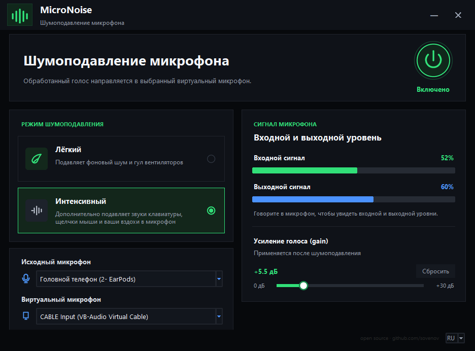

# MicroNoise

## Готовые сборки
Скачать .exe установщик и zip portable версию можно здесь: https://github.com/sovenov/MicroNoise/releases

## Описание
Шумоподавление микрофона в реальном времени с выводом обработанного голоса в
**виртуальный микрофон**.
Работает в том числе на Windows 7 и VirtualBox / VMware.





Два режима подавления шума:

| Режим | Движок | Описание |
|-------|--------|----------|
| **Лёгкий** | Speex (`libspeexdsp`) | Тот же препроцессор, что в OBS. Естественный голос, аккуратно убирает фоновый шум. Уровень подавления −60 дБ. |
| **Интенсивный** | RNNoise + VAD-гейт (`rnnoise.dll`) | Сборка [`werman/noise-suppression-for-voice`](https://github.com/werman/noise-suppression-for-voice): нейросеть RNNoise (модель werman'а) плюс VAD-гейт с настройками порога речи, удержания и упреждения. Максимальное подавление шума и помех. |

---

## Как это работает

```
Микрофон  ──►  Шумоподавление (Speex / RNNoise)  ──►  Усиление  ──►  Виртуальный кабель
(вход)          48 кГц, кадры по 10 мс                              (CABLE Input)
                                                                          │
   Другие программы (Zoom, Discord, OBS, браузер) выбирают  ◄────────────┘
   "CABLE Output" в качестве своего микрофона
```

Приложение захватывает звук с выбранного микрофона, обрабатывает его и
**проигрывает в устройство-кабель** (например, `CABLE Input (VB-Audio Virtual
Cable)`). В других программах в качестве микрофона нужно выбрать парный вход
кабеля - `CABLE Output (VB-Audio Virtual Cable)`.

---

## Требования

- **Windows 7 или новее**.
- **Виртуальный аудиокабель.** Рекомендуется бесплатный
  [VB-CABLE](https://vb-audio.com/Cable/). Подойдут также Virtual Audio Cable
  (VAC) и VoiceMeeter - приложение находит их автоматически.

## Дополнительно для запуска из исходников
- **Python 3.8 (64-бит)** - Для запуска из исходников. Встроенные библиотеки `rnnoise.dll` и
  `libspeexdsp.dll` собраны под x64, поэтому 32-битный Python не подойдёт.
Python-зависимости (ставятся через `requirements.txt`):

- `sounddevice` (PortAudio)
- `pystray` + `pillow` (иконка в системном трее)

> Сами движки шумоподавления подключаются по `ctypes` к DLL из
> `noiseclean/libs/` - отдельные пакеты `speexdsp`/`rnnoise` ставить не нужно.

---

## Установка для запуска из исходников

```bat
:: 1. Установить виртуальный кабель (если ещё не установлен): VB-CABLE
:: 2. Установить зависимости Python:
install.bat
```

или вручную:

```bat
py -3.8 -m pip install -r requirements.txt
```

## Запуск

```bat
run.bat
```

или:

```bat
py -3.8 main.py
:: либо
py -3.8 -m noiseclean
```

## Сборка в .exe (без Python)

Чтобы получить автономную сборку, которая запускается **без установленного
Python** (в т.ч. на Windows 7):

```bat
build.bat
```

или вручную:

```bat
py -3.8 -m pip install -r requirements.txt
py -3.8 -m pip install "pyinstaller==5.13.2"
py -3.8 -m PyInstaller --noconfirm --clean MicroNoise.spec
```

Результат - папка `dist\MicroNoise\`, запуск -
`dist\MicroNoise\MicroNoise.exe`. Это сборка **папкой** (onedir): надёжнее
на Windows 7, чем один файл, - ничего не распаковывается во временный каталог при
каждом запуске, все DLL грузятся прямо из папки рядом с exe. В сборку уже
включены: DLL шумоподавления (`rnnoise`, `libspeexdsp`), ускоритель `dsp_accel`, PortAudio, иконки, а
также библиотеки **UCRT** - поэтому она работает на «голой» Windows 7 без
установки Python и распространяемых пакетов.

> **Распространять нужно всю папку `dist\MicroNoise` целиком** - отдельный
> `MicroNoise.exe` без соседних файлов не запустится.

> Сборка должна выполняться на **64-битном Python 3.8** (последняя версия с
> поддержкой Windows 7). PyInstaller 6.x не поддерживает Windows 7 - поэтому
> закреплена ветка 5.x. UCRT берётся из установленного Windows SDK; если SDK
> нет, поставьте «Windows 10 SDK» (или соберите на машине, где он есть).
>
> Пользователю exe всё равно нужен установленный **виртуальный аудиокабель**
> (VB-CABLE). Его установка описана выше; упаковка установщиков кабелей
> вместе с MicroNoise описана в [инструкции Inno Setup](installer/README.md).

### Состав репозитория

В Git хранятся исходники, тесты, инструменты разработки, иконки, конфиги сборки
и три DLL в `noiseclean/libs/`, необходимые для работы и сборки приложения.
Исходный код ускорителя `dsp_accel.dll` находится в `native/`.

`build/`, `dist/`, `installer_output/`, сторонние установщики
`virtual_cables_setup/`, кэш Python и личные настройки редактора исключены
через `.gitignore`. Их можно хранить локально. Готовые установщики и portable
архивы публикуются отдельно в GitHub Releases.

---

## Использование

1. **Исходный микрофон** - выберите реальный микрофон.
2. **Виртуальный микрофон** - при **первом запуске** подбирается автоматически
   (приоритет: `CABLE Input` → `Line 1` → другие виртуальные кабели). Дальше
   ваш выбор запоминается и при последующих запусках авто-подбор не повторяется.
3. Кнопкой питания включите/выключите обработку.
4. Выберите режим - **Лёгкий** (Speex) или **Интенсивный** (RNNoise + VAD-гейт).
5. При необходимости поднимите громкость ползунком **«Усиление голоса (gain)»**
   (0…+30 дБ).

Затем в нужной программе (Discord, Zoom, OBS, браузер) выберите микрофон
**`CABLE Output (VB-Audio Virtual Cable)`**.

### Сохранение настроек

Все основные параметры запоминаются между запусками (в
`%APPDATA%\MicroNoise\settings.json`) и восстанавливаются при следующем старте:
выбранные **микрофоны**, **режим** шумоподавления, **усиление (gain)**,
**язык** интерфейса и **состояние Вкл/Выкл**. Например, если выйти из программы
с выключенной обработкой и режимом «Интенсивный» - при следующем запуске они
будут такими же.

### Язык интерфейса

Интерфейс доступен на **русском** и **английском**. Переключатель `RU / EN`
находится в правом нижнем углу окна; выбор запоминается в настройках и
применяется сразу, без перезапуска. Имена устройств не переводятся - они
приходят от системы.

### Системный трей

- Кнопка **✕** не закрывает программу, а **сворачивает её в трей** (обработка
  продолжается).
- Левый клик по значку в трее - **Открыть** окно.
- Правый клик - меню: **Открыть**, **Вкл** (включить шумоподавление),
  **Выкл** (выключить), **Завершить** (полный выход).

### Индикаторы и нагрузка на CPU

Индикаторы плавно поднимаются и медленнее опускаются. Они обновляются примерно
30 раз в секунду; расчёт громкости выполняется только по запросу интерфейса.
При сворачивании в панель задач или в трей расчёт и перерисовка индикаторов
отключаются. После восстановления окна они включаются автоматически в течение
200 мс. Шумоподавление и вывод в виртуальный микрофон продолжают работать.

### Фиксация системной громкости

Кнопка **«Фиксация громкости…»** внизу главного окна открывает настройки
системных уровней Windows для двух устройств, выбранных в MicroNoise:
**«Исходный микрофон»** (вход, например EarPods) и **«Виртуальный микрофон»**
(выход в кабель, например CABLE Input). Дополнительный список
**«Виртуальные микрофоны Windows (запись)»** включает CABLE Output и активные
Line 1 / Line 2 (Virtual Audio Cable), используемые микрофонами в браузере и
других приложениях. Для каждого доступны отдельная галочка и процент громкости.

1. Включите «Автоматически поддерживать заданную громкость».
2. Укажите отдельные уровни 0–100%, например 99% для входа и 100% для выхода.
3. Отметьте нужные CABLE Output / Line 1 / Line 2 в дополнительном списке и
   задайте их уровни. Новые обнаруженные устройства предварительно отмечены
   в окне настроек; в фиксацию они добавляются только после «Применить».
4. Укажите интервал 1–300 секунд (по умолчанию 5) и нажмите «Применить».

Можно фиксировать любые из перечисленных устройств. Дополнительные устройства
сохраняются по endpoint ID; повторно одно устройство в цикл не добавляется.
Если оно также выбрано основным входом, используется уровень основного входа.
Отключённые/неподключённые устройства из Windows при первичном поиске не
добавляются. Ранее сохранённые отсутствующие устройства остаются в списке с
пометкой «не подключено»: их можно выключить, не теряя остальных настроек.
Настройки сохраняются между
запусками; по умолчанию функция выключена. При смене выбора в главном окне
фиксация следует за новыми выбранными устройствами. Если точное соответствие
основного устройства Windows определить нельзя, старые цели отключаются, а в настройках появляется
ошибка; произвольное устройство по похожему имени не выбирается.

Фиксация работает в трее и независимо от кнопки шумоподавления. Завершение
MicroNoise останавливает её; установленный системный уровень остаётся в Windows.
При выключенной опции фоновый поток не запускается. При включённой он проверяет
уровни раз в заданный интервал и записывает значение только при отклонении
более чем на половину процентного пункта. Аудиопоток и таймер индикаторов
в этой проверке не участвуют; mute не переключается.

Системная громкость и ползунок **gain** — отдельные настройки: gain усиливает
уже обработанный звук и сам по себе не двигает системный ползунок Windows.
Фиксация восстанавливает уровень, но не устанавливает причину чужих изменений.
Для управления используется штатный
[Windows EndpointVolume API](https://learn.microsoft.com/en-us/windows/win32/api/endpointvolume/nf-endpointvolume-iaudioendpointvolume-setmastervolumelevelscalar).
Устройство сопоставляется по точному endpoint ID через
[PortAudio WASAPI](https://raw.githubusercontent.com/PortAudio/portaudio/master/include/pa_win_wasapi.h).
Новые Python-зависимости не нужны.

`tests/test_volume_lock.py` проверяет восстановление уровней, периодичность,
отключение, смену выбранных устройств, сохранение настроек, COM-сигнатуры и окно
настроек на подставных устройствах. На реальных EarPods/CABLE Input проверены
сопоставление и чтение уровней; их громкость при тестировании не менялась.


Проверка пяти устройств (EarPods, CABLE Input, CABLE Output, Line 1, Line 2) на
этой машине заняла около **1.0 мс времени CPU MicroNoise на цикл**. При
неизменных уровнях это оценочно **0.10% одного логического CPU** с интервалом
1 с и **0.05%** с интервалом 2 с. Эти величины не являются процентными пунктами
общей загрузки компьютера. Замер выполнялся без записи громкости: 1000 проверок,
медиана 3 повторов. Фактическая коррекция уровня и работа аудиодрайвера могут
добавлять затраты. [Отчёт](docs/volume-lock-performance-2026-10-23.json).

```bat
py -3.8 tools/benchmark_volume_lock.py --output build/volume-checks.json
```

### Один экземпляр

Программа запускается только в одном экземпляре. Если она уже работает
(в т.ч. свёрнута в трей или в панель задач) и вы запускаете её снова -
второй экземпляр не стартует, а вместо этого **разворачивает уже открытое
окно** и выводит его на передний план. Реализовано через именованный mutex и
событие Windows (см. `noiseclean/singleinstance.py`).

---

## Структура проекта

```
main.py                     запуск приложения
requirements.txt
run.bat / install.bat
noiseclean/
  config.py                 параметры звука, цвета, пути
  i18n.py                   переводы интерфейса (RU/EN)
  settings.py               сохранение выбора устройств и языка (%APPDATA%\MicroNoise)
  singleinstance.py         запрет второго экземпляра (mutex + событие Windows)
  suppressors.py            ctypes-обёртки Speex / RNNoise
  dsp.py                    нативные DSP-операции и резервный Python-путь
  volume_lock.py            периодическое поддержание системной громкости
  audio/
    devices.py              перечисление устройств (sounddevice)
    engine.py               движок: захват -> обработка -> вывод в кабель
    volume.py               управление громкостью устройств Windows (Core Audio)
  ui/
    theme.py                шрифты и стили ttk
    widgets.py              виджеты на Canvas (кнопки, индикаторы, слайдер...)
    assets.py               загрузка PNG-иконок через tk.PhotoImage
    app.py                  сборка окна и связь с движком
    volume_dialog.py        окно настройки фиксации громкости
  assets/                   PNG-иконки (анти-алиас, отрисованы из SVG макета)
  libs/
    libspeexdsp.dll         Speex DSP (собран из исходников, см. ниже)
    rnnoise.dll             RNNoise werman'а (модель + рантайм, см. ниже)
    dsp_accel.dll           ускорение операций над аудиобуферами
native/                     исходники и инструкция сборки DSP-ускорителя
installer/                  конфиг Inno Setup и инструкция сборки установщика
tests/                      проверки DSP, индикаторов и фиксации громкости
docs/                       отчёты о производительности
tools/
  render_icons.py           генератор PNG-иконок из SVG (нужен Pillow; только dev)
  build_dsp.py              сборка dsp_accel.dll (MSVC x64)
  benchmark_*.py            замеры производительности
```

Иконки уже отрисованы и лежат в `noiseclean/assets/`. Перегенерировать (например,
чтобы поменять цвета) можно так: `py -3.8 -m pip install pillow` и затем
`py -3.8 tools/render_icons.py`. В рантайме Pillow не нужен - Tk 8.6 грузит PNG сам.

---

## Технические детали

**Единый формат конвейера:** 48 кГц, моно, кадр 480 сэмплов (10 мс) - этого
требует RNNoise; Speex-препроцессор настроен на те же параметры.

**Устройства не на 48 кГц.** Частый случай - микрофон 44100 Гц (например на
Windows 7 / в виртуалке). В общем (shared) режиме WASAPI принимает только частоту
своего микшера, поэтому открытие на 48 кГц без конвертации даёт
`Invalid sample rate [-9997]`. Движок (`audio/engine.py`) решает это так:

1. для WASAPI-устройств поток открывается на 48 кГц с
   `WasapiSettings(auto_convert=True)` - встроенный ресемплер WASAPI сам
   приводит частоту;
2. если не вышло - пробуются другие частоты устройства и то же устройство под
   host API с программным SRC (DirectSound, MME);
3. если в итоге поток открыт не на 48 кГц - звук пересчитывается до 48 кГц для
   обработки и обратно потоковым линейным ресемплером (`_LinResampler`) - без
   накопления рассинхрона и щелчков на стыках.

**Плавность индикаторов** настраивается в `noiseclean/config.py` и влияет только
на отображение:

- `UI_TICK_MS` — период обновления видимого окна (33 мс);
- `UI_HIDDEN_TICK_MS` — период проверки команд трея и видимости скрытого окна
  (200 мс); индикаторы в это время не вычисляются и не перерисовываются;
- `UI_METER_ATTACK_MS` / `UI_METER_RELEASE_MS` — времена подъёма и спада
  (120 / 400 мс). Сглаживание зависит от прошедшего времени, а не числа тиков.

Canvas сохраняет две фигуры на индикатор и меняет их координаты вместо
удаления и создания заново. Если длина полоски в пикселях и цвет не изменились,
перерисовка не выполняется. Текст процентов обновляется только при изменении.

**Проверка изменений:**

```bat
py -3.8 -m unittest discover -s tests -v
py -3.8 tools/benchmark_meters.py
```

Бенчмарк обрабатывает синтетический звук настоящими DLL Speex/RNNoise без
открытия микрофона и кабеля. Опциональный аргумент `--engine-source` позволяет
сравнить с заранее сохранённой версией `audio/engine.py`. Замер включает
аудиоцикл и запросы уровней примерно 30 раз/с, но исключает отрисовку окна и
ожидание устройств. SHA-256 выходного звука позволяет проверить совпадение.

Отдельный замер первого этапа (только индикаторы, до C-ускорителя)
относительно `d03af53` на этой машине (60 с синтетического
звука, медиана 4 повторов, gain +8 дБ):

| Режим | Окно | CPU до, с | CPU после, с | Снижение |
|-------|------|-----------|--------------|----------|
| Speex | Видимо | 1.1875 | 1.1094 | 6.6% |
| Speex | Скрыто | 1.1875 | 1.0469 | 11.8% |
| RNNoise | Видимо | 1.8516 | 1.7500 | 5.5% |
| RNNoise | Скрыто | 1.8672 | 1.7344 | 7.1% |

Выходной звук до и после побайтово совпал в обоих режимах. Это относительное
снижение времени CPU в синтетическом замере, а не процентные пункты из
Диспетчера задач; результат на реальном микрофоне может отличаться.

**Оптимизация аудиоконвейера.** Горячие циклы преобразования float32/PCM16,
масштабирования RNNoise, усиления и клиппинга, RMS/пика и линейной интерполяции
перенесены в `dsp_accel.dll` (5632 байта). При этом сохранены порядок операций,
промежуточное округление float32, фазовое состояние ресемплера и параметры VAD.
Сами DLL Speex/RNNoise и модели не менялись. Убрана промежуточная копия сырых
входных данных в `bytes`, а также лишняя копия кадра перед RNNoise.

NumPy и новые Python-пакеты не требуются. Если ускоритель отсутствует или не
загружается, автоматически используется Python-реализация. Для диагностики её
можно включить через переменную окружения `MICRONOISE_PYTHON_DSP=1`.
Исходники и сборка ускорителя описаны в [native/README.md](native/README.md).

Сравнение с версией после оптимизации индикаторов: 30 с синтетического звука,
медиана 3 повторов, +8 дБ, настоящие DLL, без аудиоустройств и отрисовки окна:

| Сценарий | Speex: снижение времени CPU | RNNoise: снижение времени CPU |
|----------|----------------------------|-------------------------------|
| 48 кГц, окно открыто | 68.6% | 36.8% |
| 48 кГц, окно скрыто | 67.6% | 35.7% |
| 44.1 кГц, пересчёт в 48 кГц и обратно | 85.1% | 55.8% |
| 48 кГц, мониторинг и запись | 75.0% | 47.1% |

Во всех 12 сценариях выход, мониторинг и запись побайтово совпали с сохранённым
исходным кодом. Дополнительные сценарии RNNoise с принудительно открытым VAD
также включены в [полный отчёт](docs/dsp-performance-2026-10-23.json).
Результат на реальном устройстве может отличаться: это доля времени CPU
аудиоцикла, а не процентные пункты общей загрузки компьютера.

```bat
py -3.8 tools/benchmark_dsp.py --output build/dsp-results.json
```

По умолчанию сравниваются C и сохранённый Python-путь. Для сравнения со старым
кодом предусмотрен `--baseline-dir` (каталог с `engine.py` и `suppressors.py`).

**libspeexdsp.dll** собран из исходников [xiph/speexdsp](https://github.com/xiph/speexdsp)
компилятором MSVC со статической линковкой среды выполнения (`/MT`), чтобы DLL
работала на Windows 7 без дополнительных распространяемых пакетов. Экспортируются
функции препроцессора (`speex_preprocess_*`). Уровень подавления −60 дБ.

**rnnoise.dll** собран компилятором MSVC (`/MT`) из исходников RNNoise, входящих
в репозиторий [`werman/noise-suppression-for-voice`](https://github.com/werman/noise-suppression-for-voice)
(`external/rnnoise`), вместе с его обученной под голос моделью. Обёртка вызывает
`rnnoise_create / rnnoise_process_frame / rnnoise_destroy`.

**VAD-гейт** интенсивного режима портирован на Python из `RnNoiseCommonPlugin.cpp`
того же проекта: нейросеть даёт вероятность речи на каждый кадр, а гейт по
порогу глушит выход в тишину, удерживая открытым `grace`-блоки после речи и
(опционально, с задержкой) `retro`-блоки до начала речи. Кадры - по 10 мс, как
в плагине. Значения порога/удержания/упреждения заданы статично в
`noiseclean/config.py` (`RNNOISE_VAD_THRESHOLD`, `RNNOISE_VAD_GRACE_BLOCKS`,
`RNNOISE_RETRO_GRACE_BLOCKS`).

**Мониторинг** (прослушивание в наушниках) развязан с основным трактом через
кольцевой буфер и отдельный callback-поток вывода - возможные рассинхроны частот
дают лишь редкие микропровалы в прослушке и не влияют на поток в виртуальный
микрофон.

---

## Решение проблем

- **В виртуальном микрофоне нет звука.** Проверьте, что в принимающей программе
  выбран именно `CABLE Output`, а в MicroNoise - `CABLE Input`. Убедитесь, что
  кнопка питания включена.
- **Ошибка открытия устройства / нет нужной частоты.** Откройте «Звук →
  Дополнительно» и выставьте для кабеля формат 48000 Гц.
- **DLL не загружается.** Убедитесь, что используется именно 64-битный
  Python 3.8 (`py -3.8 -c "import struct;print(struct.calcsize('P')*8)"` → 64).
- **Окно открывается без рамки и не видно в трее задач.** Это нормально:
  интерфейс безрамочный (как в макете), кнопка в панели задач включается
  программно; сворачивание/закрытие - кнопками `-` и `✕` в шапке.

---

## Лицензии компонентов

- Speex DSP - BSD (Xiph.Org).
- RNNoise (ядро) - BSD (Xiph.Org / Jean-Marc Valin).
- `werman/noise-suppression-for-voice` - GPL-3. Логика VAD-гейта в
  `noiseclean/suppressors.py` портирована из его исходников, поэтому при
  распространении проекта учитывайте условия GPL-3.
